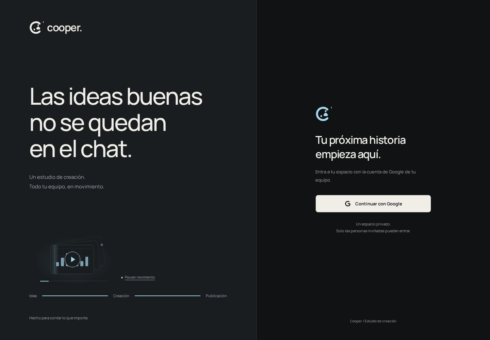
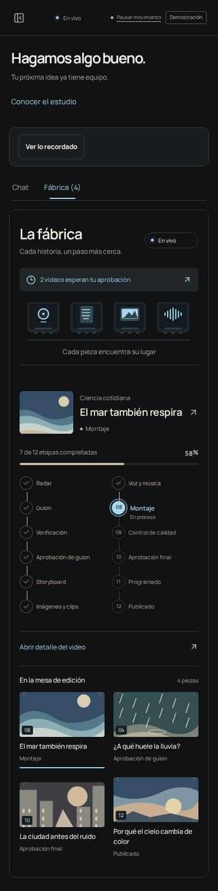

# Entrar y preparar tu espacio

[Volver a la guía](README.md) · [Siguiente: las secciones](02-secciones.md)

## Primera entrada

1. Pide a Walter que añada tu **correo de Google** a la lista permitida. Cada integrante usa el suyo.
2. Abre la dirección de Cooper que Walter confirme para el equipo. `http://localhost:3000` corresponde a la PC donde está instalada la web; desde tu celular, «localhost» sería el propio celular. No lo uses como dirección compartida.
3. En la pantalla de entrada, pulsa **Continuar con Google**.
4. Elige el mismo correo que Walter autorizó. Si tienes varias cuentas abiertas en Google, comprueba cuál seleccionaste.
5. Al entrar, abre **Mi perfil** desde la navegación. En celular, abre primero el menú.
6. Escribe tu nombre, elige **Noche**, **Día** o **Sistema**, y selecciona qué abrir primero: conversar o ver la fábrica. Pulsa **Guardar perfil**.

La captura solo muestra el botón de entrada. No se hizo un inicio de sesión real con Google para esta guía.

## Walter: dar acceso a una persona

1. Entra con tu cuenta de administrador y abre **Administración**.
2. En la lista de acceso, escribe el correo de Google de la persona y pulsa **Invitar**. Se añade a la lista permitida; comparte tú la dirección de Cooper con ella.
3. Pídele que entre una vez con ese correo. Después podrás reconocerla entre los usuarios y asignarle una marca desde el selector **Dueño**.
4. Para una baja, revisa sus recursos y pendientes antes de suspender su acceso o retirar su correo. No compartas tu sesión para sustituir su entrada.

Cooper admite hasta diez cuentas. Walter es el único administrador. Los controles de usuarios y gastos no aparecen en la cuenta normal del equipo.

## En computadora y celular

1. En computadora, **Inicio** reúne el chat y la fábrica.
2. En celular, cambia entre las pestañas **Chat** y **Fábrica**. Para ir a Marcas, Videos o Mi perfil, usa el menú.
3. Si prefieres una pantalla quieta, utiliza **Pausar movimiento**. Las etapas y los botones siguen disponibles.
4. Al terminar en un equipo compartido, usa **Cerrar sesión**.

Si no puedes entrar, sigue [los pasos de acceso](06-problemas.md). El acceso Google real y el destino definitivo de uso necesitan la aceptación de Walter; esta guía no los da por comprobados.
