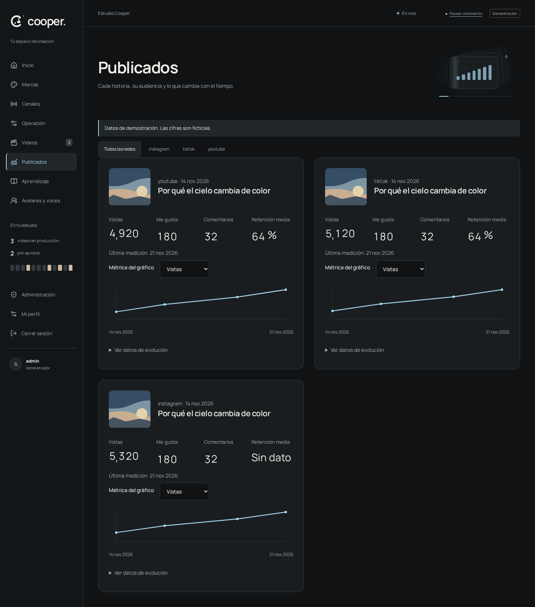
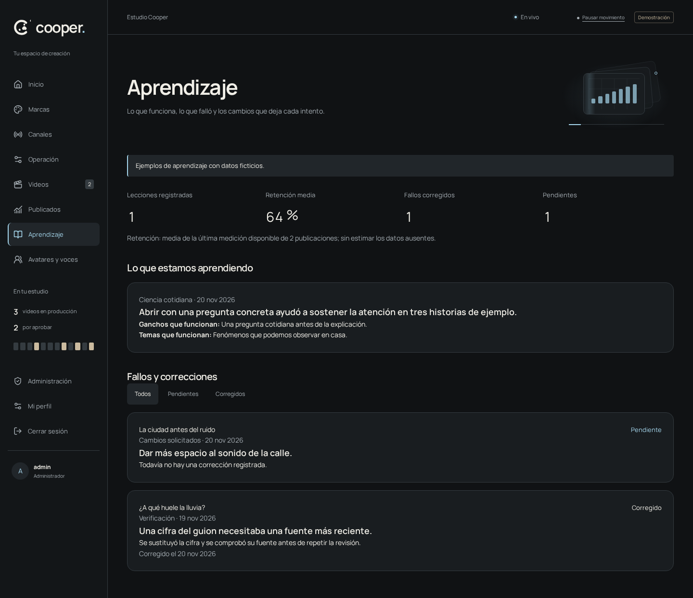
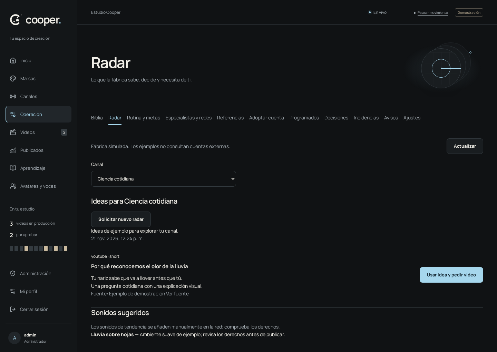
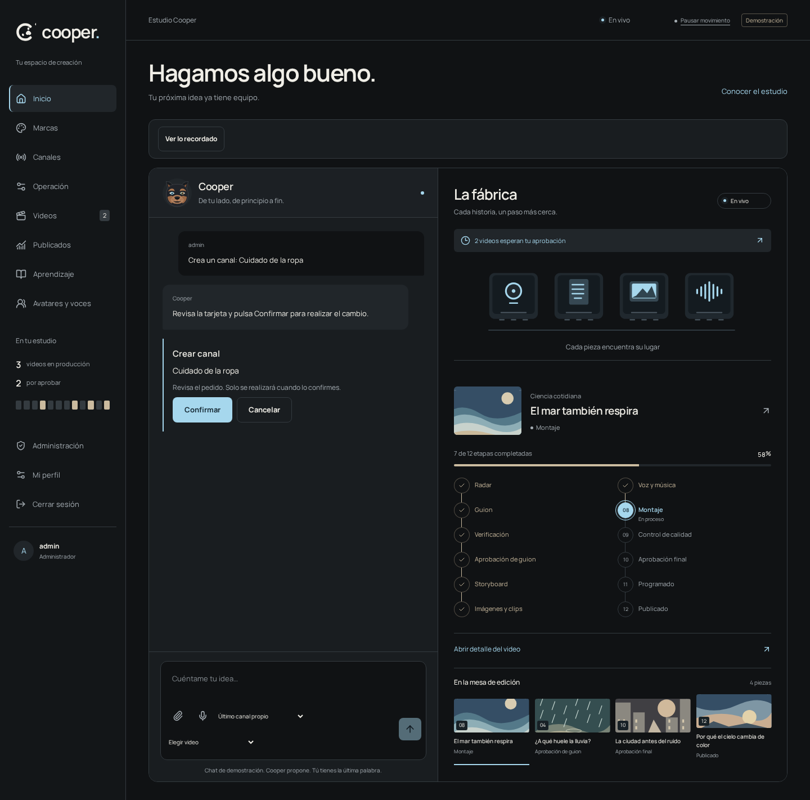

# Dónde hacer cada cosa

[Volver a la guía](README.md) · [Siguiente: un video completo](03-video.md)

## Fábrica

La Fábrica está en **Inicio**. Muestra por dónde va cada video; **Videos** permite abrir su detalle.

1. Abre **Inicio** y, en celular, pulsa **Fábrica**.
2. Selecciona una miniatura para ver su recorrido.
3. Lee la etapa activa. Si espera aprobación, abre el video y revisa su contenido.
4. Usa **Videos** para buscar otras piezas y filtrar su estado.

Las doce etapas son: Radar, Guion, Verificación, Aprobación de guion, Storyboard, Imágenes y clips, Voz y música, Montaje, Control de calidad, Aprobación final, Programado y Publicado. El indicador expresa avance por etapas; no promete minutos restantes. El recorrido detallado está en [Idea a publicación](03-video.md).

## Publicados

Aquí están las publicaciones confirmadas de los videos y las mediciones disponibles por red.

1. Abre **Publicados** en el menú.
2. Elige **Todas las redes** o una red concreta.
3. Abre el detalle de la pieza para revisar su contenido; usa el enlace de publicación cuando esté disponible para comprobarla en la red.
4. En **Métrica del gráfico**, cambia entre vistas, me gusta, comentarios y retención.
5. Abre **Ver datos de evolución** para leer fechas y cifras en una tabla. Si existe, **Retención por segundo** muestra cuánto público permanece a lo largo del video.

**Sin dato** significa que esa medición no está disponible. No significa cero. Una pieza aprobada, programada o enviada a la red todavía puede no estar publicada. Las piezas creadas en Marcas se consultan en **Marcas → [tu marca] → Publicados**; no se reúnen aquí en esta base.

## Aprendizaje

Reúne lecciones del canal y problemas observados durante la producción.

1. Abre **Aprendizaje**.
2. Lee **Lo que estamos aprendiendo** y comprueba a qué canal y fecha corresponde cada lección.
3. En **Fallos y correcciones**, filtra los pendientes o corregidos y lee qué cambio resolvió el problema.
4. Usa esa información al preparar el siguiente video. Por ejemplo: «En este video, presenta el ejemplo antes de la explicación larga».

Una lección es una orientación basada en lo registrado; no garantiza el resultado del siguiente contenido ni aprueba publicaciones. Si faltan resultados, puede no haber lecciones. Las de cada marca están dentro de **Marcas → [tu marca] → Aprendizaje**.

## Competencia

**La integración fotografiada no tiene menú ni pantalla Competencia.** No permite registrar competidores y seguir sus métricas desde una sección propia. No hay una captura de esa función porque todavía no está integrada en esta base.

Mientras se incorpora, puedes preparar referencias para tu contenido:

1. Abre **Operación → Radar**, elige el canal y revisa las ideas, sus motivos, fechas y fuentes. Radar ofrece ideas; no equivale a un seguimiento de competidores.
2. Para aportar una referencia a un video, abre su detalle y despliega **Referencias y publicación**.
3. En **Referencias**, escribe el enlace público y explica qué quieres estudiar: tema, comienzo, duración o estilo. Pulsa **Guardar referencias**. Es una indicación para ese video, no una orden para copiar contenido ajeno ni un seguimiento automático.
4. Si necesitas análisis periódico de cuentas, anótalo para Walter con los enlaces y la pregunta que deseas responder. La guía se actualizará cuando la pantalla esté integrada y comprobada.

**Operación → Referencias** tiene otro propósito: personajes y escenarios de la biblia del canal. **Marcas → Estudio** analiza el historial disponible de tus propias cuentas conectadas. Ninguna de esas pantallas es un módulo de competidores.

## Marcas

Una marca guarda su identidad, cuentas y piezas. Sus pestañas son **Calendario**, **Estudio**, **Publicados** y **Aprendizaje**.

1. Abre **Marcas** y elige la identidad con la que vas a trabajar.
2. Comprueba el dueño y **Cuentas y conexión**.
3. En **Estudio**, revisa el historial disponible de la cuenta y las sugerencias. Los horarios pueden ser hipótesis de prueba, sobre todo con pocos datos.
4. En **Calendario**, prepara una pieza y envíala a Walter para revisión.
5. Revisa sus resultados en las pestañas **Publicados** y **Aprendizaje** de esa misma marca.

Sigue [la guía de altas y piezas](04-marcas.md) para la iglesia, la tienda o una cuenta de un trabajador.

## Chat

El chat está en **Inicio**. Puedes pedir estado, proponer una idea o solicitar cambios usando frases normales.

1. Elige **Canal del chat**. Si vas a cambiar o aprobar un video concreto, elige también **Video del chat**.
2. Escribe una petición clara: «¿Qué tengo pendiente?», «Quiero un video: cómo cuidar una camisa» o «Corrige: cambia la introducción por un ejemplo».
3. Pulsa **Enviar mensaje**. Espera la respuesta antes de repetir el pedido.
4. Si Cooper propone un cambio, lee la tarjeta y comprueba el recurso y la acción. Pulsa **Confirmar** para ejecutarla o **Cancelar** para descartarla. Escribir «sí» en el chat no sustituye ese botón.
5. Comprueba el resultado en el video o la sección correspondiente. Confirmar una tarjeta para crear un video no aprueba su guion ni su montaje.

Las tarjetas caducan a los 15 minutos y pueden quedar inválidas si el recurso cambió. Pide una nueva después de revisar el estado. Si el resultado dice que debe revisarse, sigue [Problemas](06-problemas.md) antes de repetir.

Para dictar, usa el micrófono, permite su uso y revisa la transcripción antes de enviarla. **Adjuntar archivo** añade fotos o documentos: hasta 5 MB por archivo, cinco adjuntos y 15 MB en total por mensaje. Adjuntar no garantiza que Cooper haya analizado el archivo: en el modo de chat por los planes no ve fotos y los documentos no se analizan automáticamente. Describe en texto lo que necesitas que tenga en cuenta.

**Donde lo dejamos** ayuda a retomar una idea. **Retomar** prepara un mensaje; revísalo y envíalo. En **Ver lo recordado** puedes consultar y borrar recuerdos. Borrar la memoria no borra el historial visible, los archivos ni los videos. Una idea recordada tampoco es una orden ejecutada.

Incluso el chat de Walter trabaja con sus propios recursos. Para gestionar los del equipo, Walter utiliza las pantallas de administración y gestión. El modo básico temporal entiende menos variedad de frases; usa una petición breve o los formularios de la web.

## WhatsApp

Los avisos se configuran en **Mi perfil → Tus avisos por WhatsApp**. No hay una sección independiente en el menú.

1. Guarda y verifica tu número.
2. Elige qué avisos quieres recibir.
3. Cuando llegue uno, abre Cooper y revisa la pieza antes de decidir.

Los pasos completos y el significado del modo simulado están en [WhatsApp](05-whatsapp.md).

## Otros accesos útiles

| Acceso | Para qué sirve |
| --- | --- |
| Canales | Crear el espacio editorial de tus videos y abrir su biblia. |
| Operación | Radar, rutina, redes, referencias, cuentas, programados, decisiones, incidencias y avisos. Algunas funciones requieren que la conexión de fábrica esté actualizada. |
| Avatares y voces | Elegir recursos disponibles y gestionar los propios. Una voz o avatar personal requiere consentimiento y revisión; una muestra simulada no es un recurso de producción. |
| Mi perfil | Nombre, apariencia, primera pestaña del celular y WhatsApp. |
| Administración | Accesos, revisión de identidad y gastos del equipo; solo Walter. |
