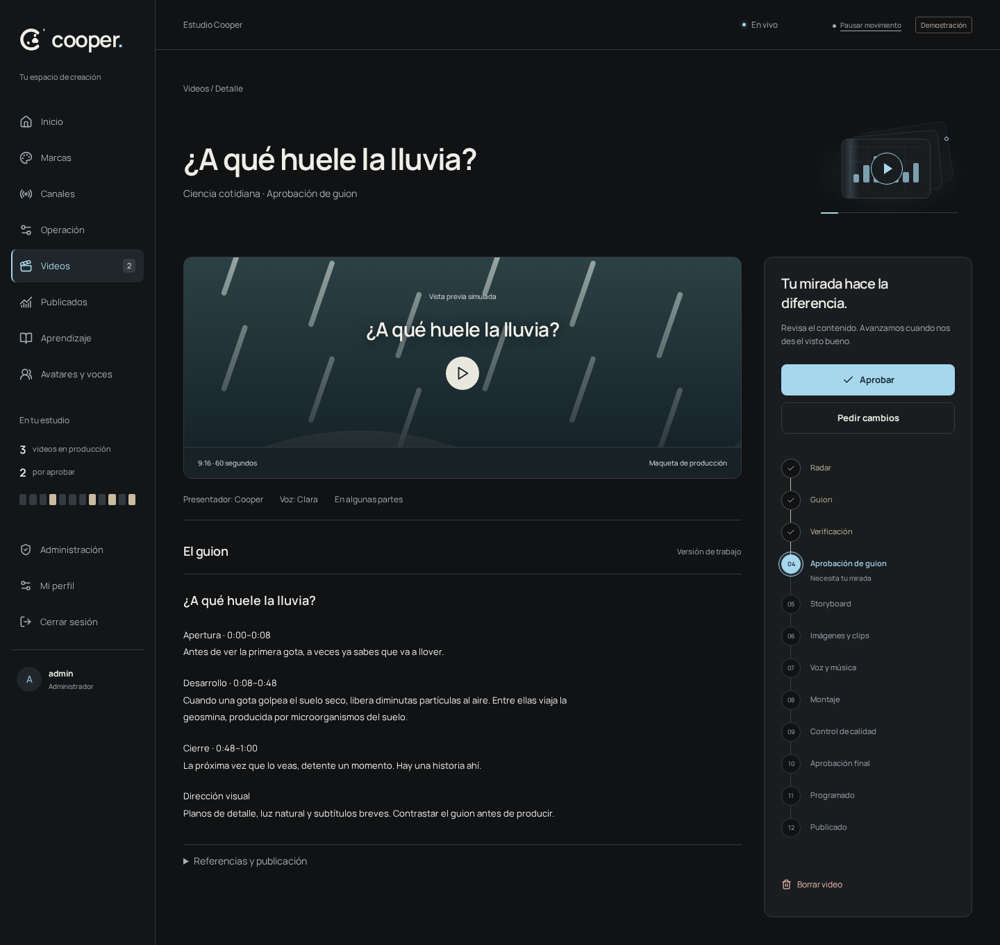
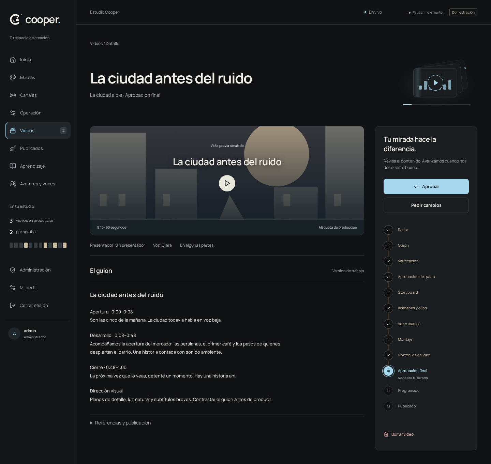

# Un video: de la idea a la publicación

[Volver a la guía](README.md) · [Siguiente: marcas y cuentas](04-marcas.md)

Ejemplo: un video sobre cómo cuidar una camisa. Este recorrido corresponde a **Videos y Fábrica**. Para un aviso, imagen, carrusel o reel creado en Marcas, sigue [el recorrido de piezas](04-marcas.md#preparar-una-pieza-y-enviarla-a-walter).

## 1. Prepara el canal

1. Abre **Canales**. Si aún no tienes uno, completa el formulario de nuevo canal y pulsa **Crear canal**.
2. Abre su biblia para revisar público, tono y reglas. La «biblia del canal» es su guía editorial.
3. Comprueba con Walter que las redes de destino estén listas antes de encargar una publicación real. Crear un canal en Cooper no conecta por sí solo una cuenta social.

## 2. Envía la idea

1. Abre **Videos → Pedir video**.
2. Elige el canal y escribe la **Idea del video**, por ejemplo: «Tres cuidados para que una camisa dure más».
3. Elige **Presentador**, **Voz** y **Presencia del avatar** si corresponden. Puedes dejar **Sin presentador** y **Elegir según el guion**. Usa recursos autorizados y disponibles.
4. Revisa los datos y pulsa **Enviar a la fábrica**. Este botón ya envía el pedido.
5. Abre el detalle del nuevo video. En **Referencias y publicación**, añade los enlaces o indicaciones que deba respetar.

También puedes pedirlo por chat. En ese caso, revisa y confirma su tarjeta una sola vez. El formulario y el chat son dos formas de hacer el mismo encargo: no uses ambos para repetirlo.

## 3. Sigue la preparación y aprueba el guion

1. En **Inicio → Fábrica**, selecciona tu video. Pasará por Radar, Guion y Verificación.
2. Al llegar a **Aprobación de guion**, abre el detalle y lee **El guion** completo.
3. Revisa datos, nombres, tono, duración prevista y referencias. En un contenido de noticia, los datos deben estar verificados antes de continuar.
4. Si hace falta corregir, pulsa **Pedir cambios**, escribe una indicación concreta en **¿Qué cambiamos?** y pulsa **Enviar cambios**. Ejemplo: «Quita la promesa de que sirve para todas las telas y añade revisar la etiqueta».
5. Cuando la versión esté bien, pulsa **Aprobar**. Es la primera aprobación y permite seguir con la producción.

## 4. Revisa el video terminado

1. Espera las etapas Storyboard, Imágenes y clips, Voz y música, Montaje y Control de calidad.
2. Al llegar a **Aprobación final**, abre el video y reproduce el montaje completo, con sonido. Revisa también los materiales por escena cuando estén disponibles.
3. Comprueba que la voz diga lo correcto, el texto se lea y las imágenes correspondan al guion. Revisa nombres, logos y permisos de los materiales.
4. Si necesita ajustes, usa **Pedir cambios** y especifica la escena o el momento. Vuelve a revisar la nueva versión antes de aprobarla.
5. Si todo está listo, comprueba la fecha de publicación y pulsa **Aprobar**. Esta segunda aprobación autoriza continuar hacia la publicación según la configuración de la fábrica.

Si aparece **Vista previa simulada**, estás viendo una demostración. Una maqueta animada no sustituye revisar el archivo final de una producción real. Si el archivo aún no está disponible, espera y consulta la incidencia antes de dar el visto bueno.

## 5. Programa y comprueba la salida

1. Si quieres una hora concreta, abre **Referencias y publicación** antes de la aprobación final.
2. Completa **Fecha y hora local** y pulsa **Programar publicación**. Comprueba que la zona del dispositivo sea la que deseas; para el equipo en Perú, normalmente Lima.
3. Revisa la fecha guardada. Programar no sustituye ninguna de las dos aprobaciones. Una fecha ya vencida puede permitir la salida cuando las aprobaciones y la conexión estén listas.
4. Consulta la etapa **Programado** o **Operación → Programados**. No vuelvas a crear el video por estar esperando.
5. Cuando la publicación quede confirmada, abre **Publicados**, localiza la pieza y comprueba el enlace en la red. Cada destino puede confirmarse en un momento distinto.
6. Más adelante, revisa las métricas y **Aprendizaje** para preparar el siguiente contenido.

Las dos aprobaciones son decisiones humanas. Reabrir la web o recibir un aviso no las concede. Un error de conexión o una aprobación pendiente no se resuelve enviando otra vez la misma idea.
