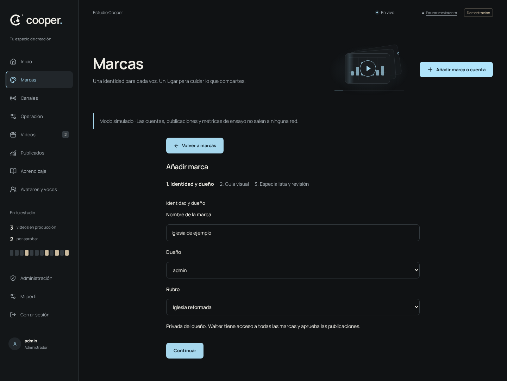
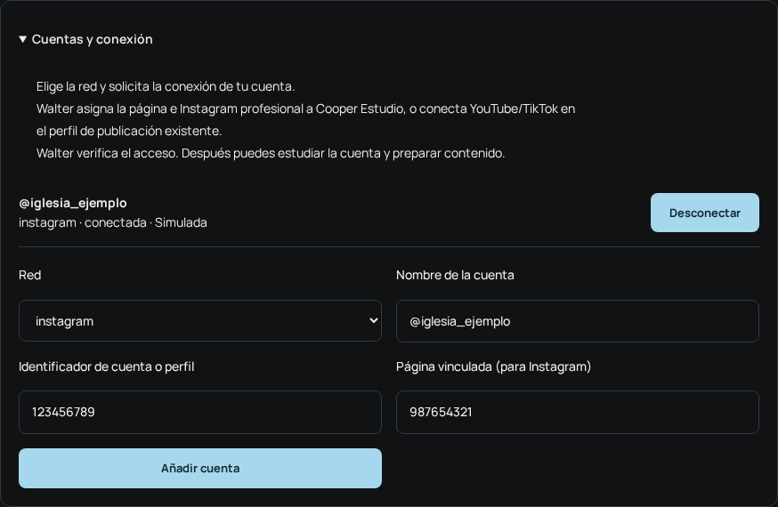
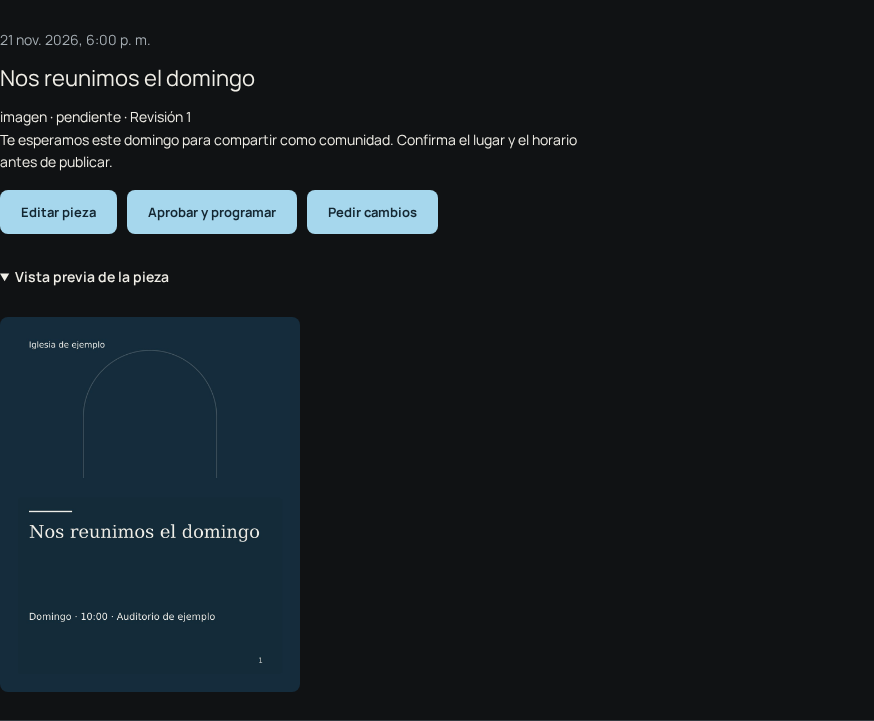

# Añadir una marca y sus cuentas

[Volver a la guía](README.md) · [Siguiente: WhatsApp](05-whatsapp.md)

**Marca** es la identidad con la que publicas. **Cuenta** es su destino en una red social. Una marca puede tener varias cuentas. El **canal** de la Fábrica organiza videos; crear una marca no crea automáticamente un canal ni conecta sus redes.

## Crear la marca

1. Acuerda con Walter el nombre, el dueño, el rubro y las cuentas que se usarán. Si el dueño será un trabajador nuevo, primero debe entrar con su correo autorizado.
2. Abre **Marcas → Añadir marca o cuenta**.
3. En **Identidad y dueño**, completa **Nombre de la marca**, comprueba **Dueño** y elige **Rubro**. Walter puede asignar la marca a un integrante; un usuario normal trabaja con su propia identidad. Pulsa **Continuar**.
4. En **Guía visual**, elige colores, tipografía, logo y tono. Si todavía no tienes el logo entre tus archivos, deja **Sin logo por ahora**. Puedes adjuntarlo desde tu chat y seleccionarlo después en **Editar guía**. Pulsa **Continuar**.
5. En **Especialista y revisión**, comprueba la versión bíblica si corresponde y la **Zona horaria**. Para el trabajo en Lima, usa `America/Lima`. El campo de versión bíblica aparece también en otros rubros; no activa por sí solo contenido religioso.
6. Pulsa **Guardar marca** y comprueba el nombre y el dueño en su cabecera.

La marca es privada de su dueño y Walter. La transferencia de dueño de una marca existente no está habilitada en esta versión: elige bien al crearla y deja cualquier cambio de dueño para revisión con Walter.

## Añadir una cuenta a una marca existente

1. Selecciona la marca y abre **Cuentas y conexión**. Para otra cuenta de la misma marca, usa este formulario; no crees otra identidad con el mismo nombre.
2. Elige **Red** y escribe **Nombre de la cuenta**, por ejemplo su nombre público o `@usuario`.
3. Completa **Identificador de cuenta o perfil** con el dato que Walter haya verificado. Para Instagram, completa también **Página vinculada (para Instagram)**.
4. Pulsa **Añadir cuenta**. Queda registrada para que Walter la verifique. Registrar el nombre no concede acceso a la red.
5. Walter comprueba la asignación y los permisos de esa cuenta, y después pulsa **Verificar conexión**. La conexión no se inicia con un login de redes desde esta pantalla.
6. Comprueba el estado de la cuenta. Si muestra **Simulada**, la verificación solo corresponde al ensayo y no acredita acceso real.
7. Una vez conectada, abre **Estudio → Estudiar la cuenta**. Lee el tamaño de la muestra y la evidencia antes de adoptar horarios o frecuencia.

| Red elegida | Qué coordinar con Walter |
| --- | --- |
| Instagram | Cuenta profesional, su identificador y página vinculada. Walter debe confirmar la condición Business antes de habilitar historias. |
| Facebook | Una página y su identificador. Este recorrido no publica en perfiles personales ni grupos. |
| YouTube o TikTok | El perfil de publicación existente que Walter haya preparado y autorizado. No basta pegar el nombre público de la cuenta. |

Los identificadores localizan una cuenta. **No pegues contraseñas, claves ni códigos de acceso en estos campos ni en el chat.** Si no tienes el dato correcto, termina la guía de marca y deja la conexión pendiente con Walter.

## Ejemplo: la iglesia

1. Crea una marca con el nombre de la congregación y el dueño acordado. Elige **Iglesia reformada** si corresponde a su identidad; si no corresponde, acuerda el rubro y el tono con Walter.
2. Define colores, logo y un tono que la congregación haya aprobado. Confirma zona horaria y versión bíblica.
3. Registra las cuentas institucionales y espera la verificación de Walter.
4. Para el primer aviso, usa una plantilla como **Encuentro del domingo** y escribe día, hora y lugar. Verifica esos datos antes de pedir revisión.
5. Si incluyes un versículo, Walter debe cotejar texto, referencia y versión con una edición autorizada y registrarlo en **Corpus bíblico cotejado por Walter**. En la pieza selecciona la **Cita bíblica cotejada** correspondiente.
6. Envía la vista previa a Walter. Un texto propuesto por el especialista requiere revisión editorial y pastoral; una cita que no coincide puede bloquear el envío o la aprobación.

## Ejemplo: una tienda de ropa

1. Crea la marca de la tienda con el dueño acordado y el rubro **Moda y tienda**.
2. Define sus colores, logo y forma de hablar. Añade las cuentas comerciales correctas.
3. En **Calendario**, elige una plantilla como **Nueva colección** y el formato que necesites.
4. Usa fotos autorizadas y comprueba nombres de productos, tallas, disponibilidad y precios que decidas incluir. El especialista no confirma el inventario de la tienda.
5. Guarda el borrador y envía la vista previa a Walter. Revisa otra vez los datos si cambian antes de publicar.

## Ejemplo: una cuenta de un trabajador

1. Walter autoriza su correo de Google y la persona entra una vez en Cooper.
2. Acuerden si es una marca propia del trabajador o una cuenta de una marca ya existente. En el segundo caso, añadan la cuenta dentro de esa marca.
3. Si es una identidad nueva, el trabajador puede crearla como propia o Walter puede elegirlo en **Dueño**. Usen **Otro rubro** si los demás no corresponden.
4. Registra la cuenta social que esa persona haya autorizado y solicita la verificación de Walter.
5. La persona prepara sus piezas y Walter las revisa. Los demás trabajadores no obtienen acceso automático a esa marca.

No registres una cuenta bajo otro dueño para resolver un problema de acceso. Coordina primero la titularidad; la conexión social y el acceso a Cooper son cosas distintas.

## Preparar una pieza y enviarla a Walter

1. Selecciona la marca y abre **Calendario**.
2. Elige la cuenta, el **Formato** y la **Plantilla**. Completa título, texto, detalles y horario. La pantalla indica la zona de la marca.
3. Si quieres ayuda, pulsa **Proponer texto con el especialista**. Lee y edita el resultado; en modo simulado es un ejemplo.
4. Añade los medios que correspondan. Usa imágenes o clips propios o autorizados. Para utilizar un video producido por la Fábrica, prepara primero su archivo final; crear la pieza no genera por sí solo ese video.
5. Pulsa **Guardar borrador**. Comprueba el resumen de la pieza.
6. Pulsa **Preparar vista previa y enviar a Walter**. Abre **Vista previa de la pieza** y verifica cómo quedaron texto, imágenes y horario.
7. Walter revisa esa versión. Puede pulsar **Pedir cambios** o **Aprobar y programar**. Una persona del equipo sin rol administrador no tiene la aprobación de Walter.
8. Si editas la pieza, se crea una nueva revisión y pierde la aprobación anterior. Vuelve a preparar y enviar la vista previa.
9. Comprueba el resultado en **Publicados** de la marca cuando la red confirme la salida. **Programada** no significa **Publicada**. Si queda en revisión por un resultado incierto, consulta a Walter antes de repetir.

En modo simulado, cuentas, publicaciones y métricas de ensayo no salen a redes. La activación real y el primer ensayo de publicación siguen sujetos a la aceptación de Walter; esta guía documenta los controles disponibles.
