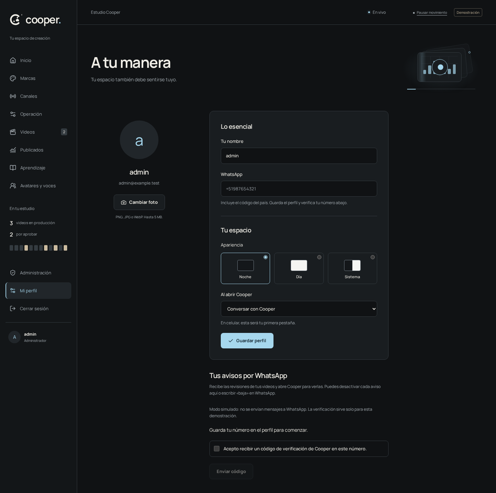

# Recibir avisos por WhatsApp

[Volver a la guía](README.md) · [Siguiente: resolver problemas](06-problemas.md)

WhatsApp avisa cuando necesitas revisar un guion o un video y cuando hay una publicación. La configuración está en **Mi perfil**. Guardar el teléfono por sí solo no activa mensajes.

## Configurar tu número

1. Abre **Mi perfil** y escribe tu número en **WhatsApp**, con `+`, código de país y número completo, sin espacios. Para Perú: `+51` seguido de tu número.
2. Pulsa **Guardar perfil**.
3. Baja hasta **Tus avisos por WhatsApp**. Comprueba el número y acepta recibir el código de verificación.
4. Pulsa **Enviar código**. Introduce las seis cifras recibidas y pulsa **Verificar número**. El código dura diez minutos; no lo compartas.
5. Cuando aparezca verificado, marca los avisos que quieres: **Guion listo para aprobar**, **Video listo para la aprobación final** y **Video publicado**.
6. Pulsa **Guardar avisos**. Walter tiene además opciones para alertas de gasto y piezas de marcas.

Si ves **Modo simulado**, no se envían mensajes a WhatsApp. El código mostrado en una demostración sirve solo para ese ensayo. Al usar el servicio real hará falta una verificación real. Las capturas de esta guía no muestran teléfonos ni códigos de verificación reales.

## Revisar un aviso

1. Comprueba qué pieza y revisión menciona el aviso.
2. Abre el enlace de Cooper. Si te pide entrar, usa tu correo autorizado.
3. Lee el guion o reproduce el video y decide desde sus controles. **Abrir el enlace no aprueba nada**.
4. Si recibes botones de aprobación dentro de WhatsApp y esa modalidad está habilitada, pulsarlos sí es una decisión. Revisa primero la versión correspondiente en Cooper.
5. Vuelve a Cooper para comprobar el nuevo estado. Un enlace vencido o una revisión antigua puede dejar de servir; abre la pieza actual desde la web.

Los enlaces de aviso tienen una vigencia de 24 horas y pueden invalidarse antes si cambia la revisión o tu verificación. No los reenvíes para que otra persona entre en tu cuenta. Los avisos de videos son propios; los de piezas de marca se dirigen a la revisión de Walter.

## Cambiar el número o dejar de recibir avisos

1. Para quitar un tipo de aviso, desmárcalo en **Mi perfil** y pulsa **Guardar avisos**. También puedes escribir «baja» al WhatsApp de Cooper para desactivar los avisos.
2. Si cambias el teléfono, guarda el perfil y verifica el nuevo número.
3. Vuelve a elegir tus avisos. El cambio de número borra la verificación y preferencias anteriores e invalida sus enlaces.

Si no llega el código, revisa [Problemas con WhatsApp](06-problemas.md). La configuración real de mensajería y sus plantillas debe estar aceptada antes de esperar avisos externos. Puedes seguir revisando los pendientes desde Cooper mientras tanto.
