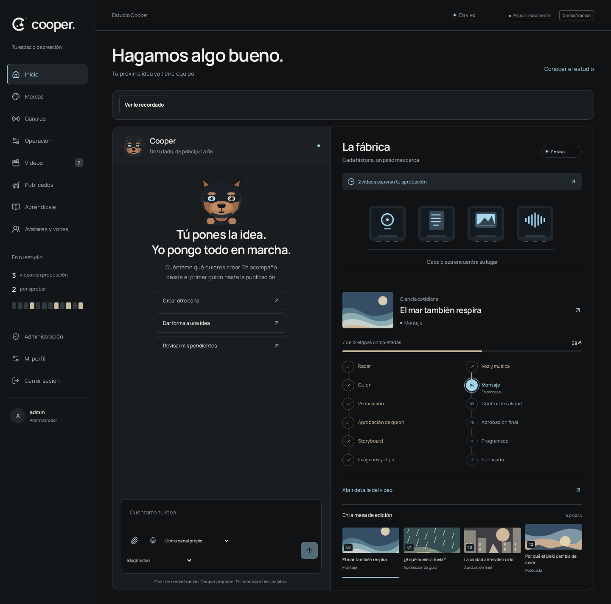

# Cooper: guía para Walter y el equipo

Cooper es el estudio privado del equipo para preparar contenido, seguir su producción, revisarlo y consultar sus resultados. En **Inicio** puedes conversar con Cooper y ver la **Fábrica**. En **Marcas** organizas la identidad y las publicaciones de una iglesia, una tienda o una cuenta del equipo.

Esta guía corresponde a la **integración 3 local, base `de397f3`, revisada el 21 de noviembre de 2026 en Lima**. Las capturas muestran esa aplicación con datos ficticios y el modo **Demostración**. Los nombres, cuentas, publicaciones y cifras son ejemplos. No acreditan publicaciones reales ni que todas las conexiones estén activadas. La dirección y las funciones habilitadas para el equipo las confirma Walter.

## Empieza aquí

1. [Entra con tu cuenta y prepara tu espacio](01-entrada.md).
2. [Ubica las secciones y aprende a usar el chat](02-secciones.md).
3. [Lleva un video desde la idea hasta la publicación](03-video.md).
4. [Añade una marca y sus cuentas](04-marcas.md).
5. [Configura los avisos de WhatsApp](05-whatsapp.md).
6. [Resuelve un problema sin duplicar pedidos](06-problemas.md).
7. [Consulta una palabra del glosario](07-glosario.md).

## Cómo organizarse entre tres o cuatro personas

1. Cada persona entra con su propio correo autorizado. No compartan una sesión para trabajar en cuentas distintas.
2. Antes de empezar una pieza, acuerden quién será su dueño. Los demás miembros del equipo no ven automáticamente sus recursos. Walter tiene acceso administrativo; las marcas son visibles para su dueño y Walter.
3. La persona dueña prepara el contenido y revisa sus videos. En la Fábrica hay dos paradas: aprobación del guion y aprobación final. En Marcas, **Walter aprueba cada revisión de una pieza**.
4. Una persona puede ayudar con ideas, textos o revisión editorial, pero eso no le concede acceso a la cuenta de otra. Compartan material por el medio acordado con Walter.
5. Al comenzar el día, revisen las aprobaciones pendientes. Al terminar, comprueben qué quedó programado, publicado o pendiente de resolver.

## Antes de pulsar una aprobación

1. Comprueba el título, el canal o la marca y la cuenta de destino.
2. Lee el guion o el texto y revisa imágenes, voz, fechas y enlaces.
3. Comprueba el horario. En videos se usa la hora local de tu dispositivo; las marcas muestran su zona horaria.
4. Aprueba solo cuando esa versión esté lista. Una respuesta del chat o una animación no demuestra que una publicación haya salido.

**Qué falta en esta versión:** no existe todavía una pantalla llamada **Competencia**. Su alcance actual y las alternativas disponibles están en [Competencia](02-secciones.md#competencia). Marcas, WhatsApp y otras conexiones pueden estar en modo simulado o pendientes de activación. Si ves «Simulado» o «Demostración», estás trabajando con ejemplos.

Para quien mantenga esta guía: [origen y reproducción de las capturas](capturas/README.md) e [informe de la misión](../informes/total-guia.md).
